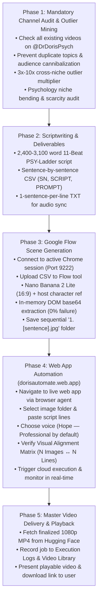

# Doris — Master YouTube Psychology Video Production Engine

[](https://www.youtube.com/@DrDorisPsych)
[](https://dorisautomate.web.app)
[](https://www.kaggle.com/code/dorisautomate/doris-storyteller-worker)
[](https://huggingface.co/datasets/Dorisautomate/automation-assets)
[](LICENSE)

An end-to-end autonomous AI video production skill engineered specifically for **[Dr Doris Psych](https://www.youtube.com/@DrDorisPsych)**. 

Once triggered, Doris operates with **100% continuous autonomy (Zero-Guidance Mandate)**, seamlessly progressing from initial channel audit and duplicate prevention, through 11-beat psychology scriptwriting, Google Flow batch image generation via active Chrome, live web app video assembly on [dorisautomate.web.app](https://dorisautomate.web.app), to final synchronized 1080p MP4 delivery.

---

## ⚡ Architecture & Pipeline Flowchart



---

## 🚀 Trigger Invocations

Activate this skill in any Antigravity or Gemini-compatible assistant by saying:

- `"/doris"`
- `"/doris generate for me a video for my channel"`
- `"Doris, generate for me a video for my channel"`
- `"Run the Doris pipeline to create a video for Dr Doris Psych"`
- `"Generate a complete video from scratch for my channel"`

---

## 📋 The 5 Production Phases

### Phase 1: Mandatory Channel Audit & Outlier Mining
- **Duplicate Prevention**: Before topic research begins, Doris queries `https://www.youtube.com/@DrDorisPsych` to catalog all existing videos, ensuring the new video explores an unaddressed, high-demand angle.
- **Outlier Mining Formula**: Scans adjacent niches (Finance, Tech, True Crime) for breakout titles with a **$3.0\text{x}$ to $10.0\text{x}+$ Outlier Multiplier** relative to channel baselines:
  $$\text{Outlier Multiplier} = \frac{\text{Candidate Video Views}}{\text{Candidate Channel Median Views}}$$
- **Niche Bending**: Re-maps viral tension onto human behavior (Jungian shadow, vagal regulation, boundary defense, counterfeit virtue).
- **YouTube Scarcity Score**: Enforces **4 or 5 out of 5 scarcity** (near-zero direct search competition).

### Phase 2: Scriptwriting & Deliverables (PSY-Ladder System)
- **Word Count**: 2,400 to 3,100 words (~14–16 minutes spoken at 180 wpm).
- **11 Beats**: Hook, Stay Line, Pain Deepening, Science Reversal, Ladder Map, Levels 1–2 Trap, Levels 3–4 Turn, Levels 5–6 Apex, 3 Objections Knockdown, The One Tool Install, Payoff & Level Confession CTA.
- **Sentence-by-Sentence CSV**: Columns `SN,SCRIPT,PROMPT` with Google Imagen-compliant 2D sitcom prompts featuring the channel host character (`A cartoon man with glasses in a navy sweater over a white collared shirt`).
- **1-Sentence-per-Line TXT**: Exact 1:1 pairing with CSV rows for TTS voiceover alignment.

### Phase 3: Google Flow Scene Generation
- Connects to user's active Chrome session (`localhost:9222`) at Google Flow (`flow.google.com`).
- Uploads CSV dataset and selects **Nano Banana 2 Lite** (16:9).
- Attaches host character reference image.
- **In-Memory DOM Extraction**: Extracts base64 image data directly from memory via DevTools script evaluation, bypassing Windows Attachment Execution Service (AES) download locking.
- Saves sequentially into `C:\Users\doris\Downloads\<Title_Folder>\1. [sentence].jpg`.

### Phase 4: Web App Automation ([dorisautomate.web.app](https://dorisautomate.web.app))
- Browser agent loads the live production web app.
- Selects the downloaded image folder and pastes script lines into the interface.
- Selects **✨ Hope — Professional, Clear & Natural** as the default cloned voice.
- Verifies the **Visual Alignment Matrix** (`🟢 Aligned: N Images ↔ N Sentences`).
- Triggers cloud execution and polls Kaggle T4 GPU progress in real time.

### Phase 5: Master Video Delivery & Playback
- Fetches the compiled 1080p MP4 from Hugging Face Datasets repository (`Dorisautomate/automation-assets`).
- Verifies registration in the web app's **Execution Logs & Video Library** dashboard.
- Delivers the final playable video URL and download link directly in chat.

---

## 🛠️ Infrastructure & Cloud Endpoints

| Component | Endpoint | Role |
|---|---|---|
| **YouTube Channel** | [`@DrDorisPsych`](https://www.youtube.com/@DrDorisPsych) | Target channel for audience calibration & duplicate checks |
| **Web Frontend** | [`dorisautomate.web.app`](https://dorisautomate.web.app) | Live production studio & historical video library |
| **Image Engine** | Google Flow (`ee8f4722-38cb-4363-967f-057725e7c3c6`) | Nano Banana 2 Lite 2D animation generation |
| **Compute Server** | Kaggle T4 GPU (`doris-storyteller-worker`) | Zero-shot F5-TTS synthesis & FFmpeg video stitching |
| **Asset Storage** | Hugging Face (`Dorisautomate/automation-assets`) | Reference audio storage, job metadata & video hosting |

---

## 📦 Installation & Setup

To install this skill into your local environment:

```bash
# Clone the repository into your skills directory
git clone https://github.com/Dorisautomate/Doris.git ~/.gemini/config/skills/doris
```

Or copy `SKILL.md` directly into your Antigravity skills path:
```text
C:\Users\doris\.gemini\config\skills\doris\SKILL.md
```

---

## 📄 License

Distributed under the MIT License. See `LICENSE` for details.
